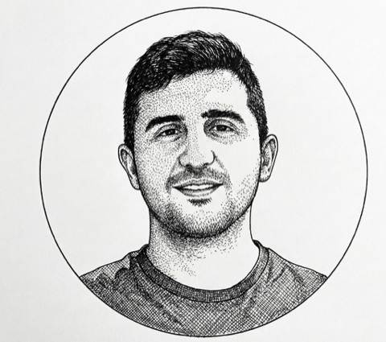

<section class="hero-section">
<div class="container home-grid">

<div class="home-left">


<div class="home-identity">
<h1 class="home-name">Muhammet Özkaraca</h1>

<p class="home-title">Political Science Ph.D. Student<br />UNC-Chapel Hill</p>

<div class="home-inline-nav">
<a href="/research">Research</a> <span>·</span> <a href="/teaching">Teaching</a> <span>·</span> <a href="/resources">Resources</a>
</div>

<div class="social-links">
<button type="button" class="contact-email-toggle" aria-expanded="false" aria-controls="contact-email"><svg viewBox="0 0 24 24" fill="none" stroke="currentColor" stroke-width="1.7" stroke-linecap="round" stroke-linejoin="round" aria-hidden="true"><rect x="3" y="5" width="18" height="14" rx="2"/><path d="m3.5 6.5 8.5 6.5 8.5-6.5"/></svg><small>Email</small></button>
<a href="CV.pdf" target="_blank" rel="noopener noreferrer"><svg viewBox="0 0 24 24" fill="none" stroke="currentColor" stroke-width="1.7" stroke-linecap="round" stroke-linejoin="round" aria-hidden="true"><path d="M14 3H7a2 2 0 0 0-2 2v14a2 2 0 0 0 2 2h10a2 2 0 0 0 2-2V8z"/><path d="M14 3v5h5"/><path d="M9 13h6"/><path d="M9 17h4"/></svg><small>CV</small></a>
<a href="https://www.linkedin.com/in/muhammet-ozkaraca/" target="_blank" rel="noopener noreferrer"><svg viewBox="0 0 24 24" fill="none" stroke="currentColor" stroke-width="1.7" stroke-linecap="round" stroke-linejoin="round" aria-hidden="true"><path d="M16 8a6 6 0 0 1 6 6v7h-4v-7a2 2 0 0 0-4 0v7h-4v-7a6 6 0 0 1 6-6z"/><rect x="2" y="9" width="4" height="12"/><circle cx="4" cy="4" r="2"/></svg><small>LinkedIn</small></a>
<a href="https://github.com/muhammetozkaraca" target="_blank" rel="noopener noreferrer"><svg viewBox="0 0 24 24" fill="none" stroke="currentColor" stroke-width="1.7" stroke-linecap="round" stroke-linejoin="round" aria-hidden="true"><path d="M9 19c-5 1.5-5-2.5-7-3m14 6v-3.87a3.37 3.37 0 0 0-.94-2.61c3.14-.35 6.44-1.54 6.44-7A5.44 5.44 0 0 0 20 4.77 5.07 5.07 0 0 0 19.91 1S18.73.65 16 2.48a13.38 13.38 0 0 0-7 0C6.27.65 5.09 1 5.09 1A5.07 5.07 0 0 0 5 4.77a5.44 5.44 0 0 0-1.5 3.78c0 5.42 3.3 6.61 6.44 7A3.37 3.37 0 0 0 9 18.13V22"/></svg><small>GitHub</small></a>
<a href="https://x.com/muhammetozkrca" target="_blank" rel="noopener noreferrer"><svg viewBox="0 0 24 24" fill="none" stroke="currentColor" stroke-width="1.7" stroke-linecap="round" stroke-linejoin="round" aria-hidden="true"><path d="M4 4l11.7 16H20L8.3 4z"/><path d="M4 20l6.8-6.8"/><path d="M13.2 10.8 20 4"/></svg><small>X</small></a>
</div>

<div id="contact-email" class="contact-email" hidden>
<a href="mailto:ozkaraca@unc.edu">ozkaraca@unc.edu</a>
</div>
</div>
</div>

<div class="home-bio">
<p>I am a Ph.D. student in the <a href="https://politicalscience.unc.edu/" target="_blank" rel="noopener noreferrer">Department of Political Science</a> at the University of North Carolina at Chapel Hill. Before starting my Ph.D., I worked as a project assistant at the International Centre for Migration Policy Development. I hold an M.A. in <a href="https://politicalscience.ceu.edu/" target="_blank" rel="noopener noreferrer">Political Science</a> from Central European University and a B.A. in <a href="https://ir.bilkent.edu.tr/" target="_blank" rel="noopener noreferrer">International Relations</a> from Bilkent University.</p>

<p>I work at the intersection of international relations and comparative politics. My research examines how domestic politics shapes international outcomes, with a focus on sovereign finance and political regimes. You can find my CV <a href="CV.pdf" target="_blank" rel="noopener noreferrer">here</a>.</p>
</div>

<section class="home-research" id="research">

```{r papers, echo=FALSE}
htmltools::includeHTML("_papers.html")
```

</section>

</div>
</section>
